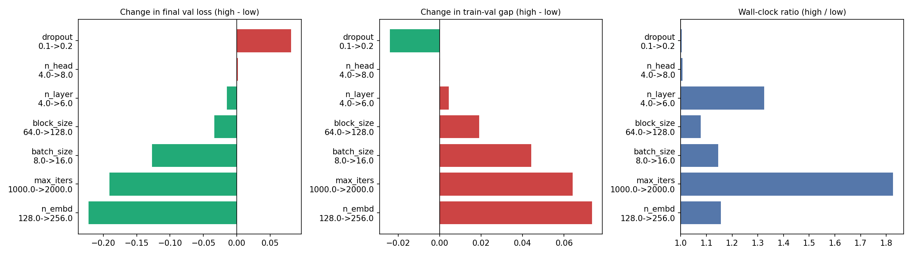

# nanoGPT Hyperparameter Experiments (Group 5)

Deep Learning assignment, CSCE @ UNT: understanding and experimenting with the GPT architecture
using [Andrej Karpathy's nanoGPT](https://github.com/karpathy/nanoGPT).

This repository contains the code, configuration, logs and results for **128 training runs** of a
character-level GPT on Tiny Shakespeare. Every combination of 7 hyperparameters (2 values each) was run.

## Headline result

| | Value |
|---|---|
| Best validation loss | **1.658** |
| Best configuration | block_size 128, n_layer 4, n_head 8, n_embd 256, batch_size 16, max_iters 2000, dropout 0.1 |
| Worst validation loss | 2.329 (block_size 64, n_layer 4, n_head 4, n_embd 128, batch_size 8, max_iters 1000, dropout 0.2) |
| Total GPU time | 106.6 minutes on a Colab T4 |

Main effects on validation loss (average of 64 runs at each level; negative = better):

| Change | Δ val loss |
|---|---|
| n_embd 128 → 256 | −0.222 |
| max_iters 1000 → 2000 | −0.191 |
| batch_size 8 → 16 | −0.127 |
| block_size 64 → 128 | −0.034 |
| n_layer 4 → 6 | −0.015 |
| n_head 4 → 8 | +0.002 |
| dropout 0.1 → 0.2 | +0.081 |

## Experiment grid

| Hyperparameter | Values |
|---|---|
| block_size | 64, 128 |
| n_layer | 4, 6 |
| n_head | 4, 8 |
| n_embd | 128, 256 |
| batch_size | 8, 16 |
| max_iters | 1000, 2000 (lr_decay_iters set equal) |
| dropout | 0.1, 0.2 |

2^7 = 128 runs. I am the only member of Group 5, so I ran the complete grid myself
(all 128 combinations).

**Fixed for every run:** base config `config/train_shakespeare_char.py`, learning rate 1e-3 → min 1e-4
(100 warmup steps, cosine decay), AdamW (beta2 0.99, weight decay 0.1), grad clip 1.0, no bias,
`compile=False`, evaluation every 100 steps on 50 batches, seed 1337. Full settings are in `experiment_config.json`.

## Repository contents

| File / folder | What it is |
|---|---|
| `nanoGPT_experiments_group5.ipynb` | The Colab notebook that runs everything (with its outputs) |
| `nanoGPT/` | The nanoGPT code exactly as it was run: `model.py`, `train.py` and `sample.py` (with the 3 small changes below), `configurator.py`, `data/shakespeare_char/prepare.py` and Karpathy's MIT `LICENSE` |
| `nanoGPT/config/train_shakespeare_char.py` | The base configuration file every run starts from |
| `experiment_config.json` | Exact grid, fixed settings, sampling settings and nanoGPT commit |
| `run_commands.txt` | The exact `train.py` command (all settings) for each of the 128 runs |
| `summary.csv` | One row per run: params, peak memory, time, train/val loss, gap, tokens seen |
| `main_effects.csv` | Average effect of each hyperparameter |
| `all_runs.json` | Full loss curves (every eval step and every 10th iteration) for all 128 runs |
| `logs/` | Raw `train.py` output for every run, including the exact command used. Grouped into 4 files by block_size and n_layer (32 runs each) |
| `samples.md` | A generated text sample from every run, best to worst |
| `figures/` | Loss curves, main effects, overfitting and cost plots |

Run names follow `bs<block_size>_L<n_layer>_H<n_head>_E<n_embd>_B<batch_size>_it<max_iters>_do<dropout>`.
Model checkpoints were saved to Google Drive and are not included here because of their size.

## How to reproduce

1. Open `nanoGPT_experiments_group5.ipynb` in Google Colab and select **Runtime → Change runtime type → T4 GPU**.
2. Optional: set `SMOKE_TEST = True` in the first cell for a one-minute check.
3. Click **Runtime → Run all**. The notebook:
   - clones nanoGPT and prepares the Shakespeare character dataset,
   - runs all 128 configurations (`train.py` + `sample.py` for each),
   - saves logs, results and figures to Google Drive. If Colab disconnects, run all again: finished runs are skipped.
4. To run a single experiment by hand instead, `cd nanoGPT`, run `python data/shakespeare_char/prepare.py`, then copy any line from `run_commands.txt`.

## Changes to nanoGPT

nanoGPT is used unchanged (commit `3adf61e`) except for three small additions. They are already applied in the `nanoGPT/` folder here, and the notebook applies them automatically in Colab:

1. The course's checkpoint-saving snippet is appended to `train.py`, also storing `config` so that
   `sample.py` loads the character vocabulary (`meta.pkl`) instead of falling back to GPT-2 tokens.
2. One line in `train.py` prints peak GPU memory.
3. `sample.py` loads checkpoints with `weights_only=False` for compatibility with newer PyTorch.

## Credits

- nanoGPT by Andrej Karpathy, MIT License: https://github.com/karpathy/nanoGPT
- Assignment, starter notebook and checkpoint-saving snippet: Amir Mirzaeinia, CSCE @ UNT
- The experiment notebook and report drafts were prepared with help from Claude (Anthropic).
